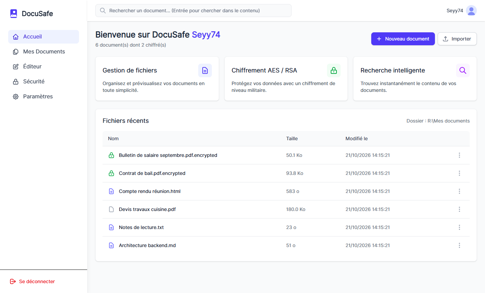
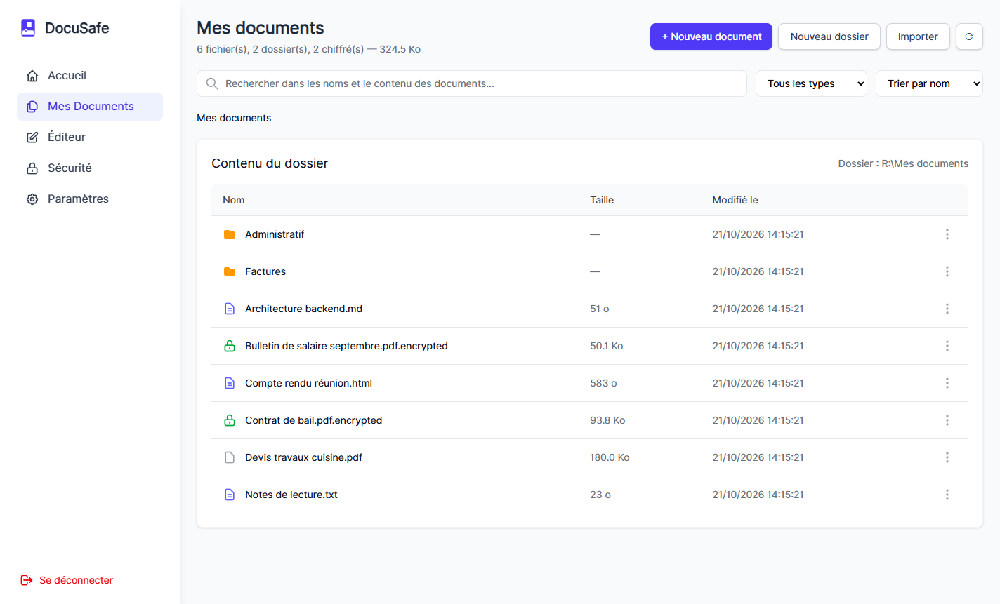
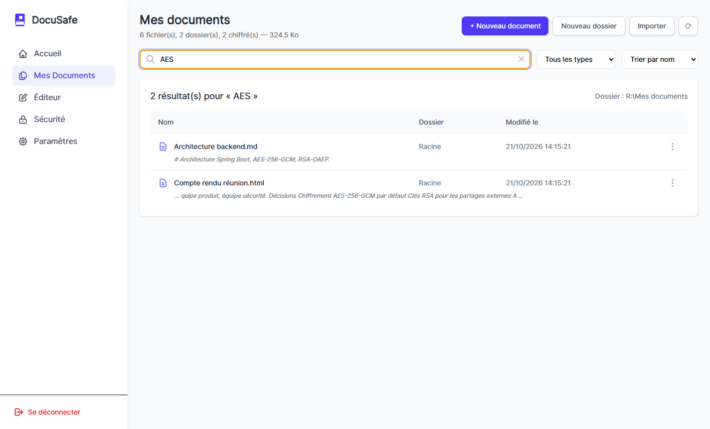
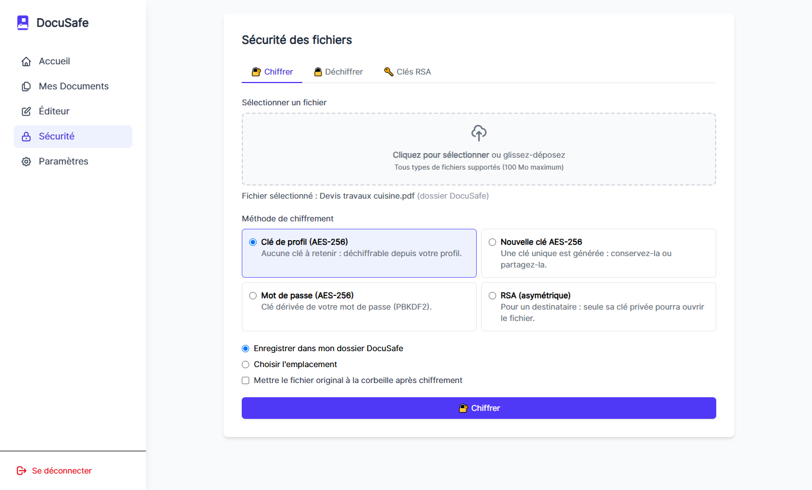
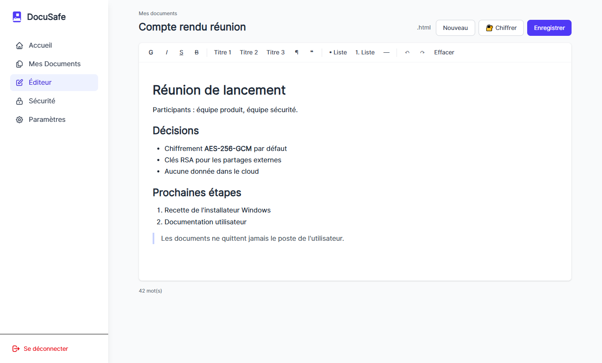

# 🔐 DocuSafe

**DocumentSafe** is a secure desktop document management application designed to work offline. It enables users to store, organise, consult and search confidential documents locally, without relying on the cloud.



---

## 🛠️ Technical stack

- Frontend: **Angular 19 (integrated into Electron 45)**
- Backend: **Java 17 + Spring Boot 3** (encryption service, listens on `127.0.0.1` only)
- Local storage: **electron-store** for profiles, the **file system** for documents (a folder chosen by each user)
- Packaging: **Windows installer `.exe`** via Electron Builder (NSIS)

---

## ✨ Features

- 🔒 File encryption / decryption: **AES-256-GCM** (profile key, generated key or password) and **RSA-3072** (hybrid RSA-OAEP + AES)
- 🔑 RSA key pair generation (PEM), copy / export of keys
- 🔍 Integrated search system: file names **and content** (txt, md, html, csv, json…), sub-folders included
- 📝 Rich text editor (headings, lists, bold/italic…, `.html`) and plain text / Markdown editor, `Ctrl+S` to save
- 📁 File management: folders, import (dialog or drag & drop), rename, open with the default app, show in Explorer, move to the recycle bin
- 👤 Local multi-profile management: profile list, avatar, pseudo, storage folder, profile deletion
- 🔐 Local authentication: optional password per profile (scrypt), which also protects the profile key
- 🔄 Real-time synchronisation: the document list updates as soon as the folder changes (another profile, Explorer…)
- ✅ Fluid and responsive interface

---

## 📸 Screenshots

| Documents | Full-text search |
| --------- | ---------------- |
|  |  |
| **Encryption** | **Editor** |
|  |  |

---

## 🚀 First steps

1. **Create a profile**: enter a pseudo (no account, nothing leaves the computer). Existing profiles are listed on the welcome screen.
2. **Choose a storage folder**: your documents stay in this folder. Keep *"Activer le chiffrement AES avec une clé de profil"* checked to get a profile key: files can then be encrypted and decrypted without handling a key each time.
3. **Add documents**: *Importer*, drag & drop on the *Mes documents* page, or write one in the *Éditeur*.
4. **Encrypt**: in the `⋮` menu of a file, choose *Chiffrer*, then a method:
   | Method | When to use it |
   | ------ | -------------- |
   | Profile key | Your own files: nothing to remember |
   | New AES key | A file to share: give the generated key to the recipient |
   | Password | A file you want to open anywhere with a password |
   | RSA | A file for someone who gave you their public key |
5. **Decrypt**: *Déchiffrer* in the `⋮` menu (or click the name of a `.encrypted` file). DocuSafe detects which key is needed and restores the original file name.
6. **Protect the profile** (*Paramètres*): set a password; it is asked at every launch and encrypts the profile key. Keep a copy of the profile key (*Afficher la clé*) somewhere safe.

---

## 📦 Installation

### Prerequisites

- [Node.js](https://nodejs.org/) 20+
- [Java 17+](https://adoptium.net/) (`JAVA_HOME` set, or `java` in the `PATH`)
- [Maven](https://maven.apache.org/)

### Launch the backend (dev mode)
```bash
cd backend
mvn spring-boot:run
```

### Run frontend (dev mode)
```bash
cd frontend
npm install
npm run dev:full        # ng serve + Electron (Electron waits for http://localhost:4200)
```
`npm run start` and `npm run electron` can also be launched separately.

> npm 11 blocks dependency install scripts by default: the Electron download is already approved in `package.json` (`allowScripts`).
> If Electron reports that it *failed to install correctly*, run `node node_modules/electron/install.js`.

### Run the built application (without ng serve)
```bash
cd frontend
npm run build:backend   # builds backend/target/docusafe-backend.jar
npm run electron:prod   # builds Angular, then Electron starts the backend by itself
```

### Build the Windows installer
```bash
cd frontend
npm run dist            # -> frontend/release/DocuSafe Setup 1.0.0.exe
```
The installer embeds the backend jar and starts it automatically (and stops it when the app closes); Java 17+ must be installed on the target machine. The installer is not code-signed, so Windows SmartScreen may show a warning on first launch.

> Set the `DOCUSAFE_USER_DATA` environment variable to store profiles in another folder (tests, portable use).

## 🧪 Tests

- **Backend**: unit and API tests with JUnit / MockMvc: `cd backend && mvn test`
- **Frontend**: tests with Jasmine and Karma: `cd frontend && npm run test:ci` (or `npm test` in watch mode)

## 🗂️ Project structure

```
backend/                        Spring Boot encryption service
  src/main/java/com/docusafe/
    controller/                 REST endpoints (/api/encryption, /api/decryption, /api/keys/rsa, /api/health)
    crypto/                     FileCipher (file format, AES-GCM, PBKDF2, RSA-OAEP), PemKeys
    service/  model/  exception/
  src/test/java/                JUnit + MockMvc tests
frontend/
  main.js                       Electron main process: window, app:// protocol, backend launch,
                                profiles & authentication, file access, search, folder watching
  src-electron/preload.js       API exposed to Angular (window.electronAPI / window.electronStore)
  src/app/
    pages/                      welcome, user-start-choices, home, documents-page, editor, security, settings
    components/                 sidebar, files-container (file list + actions menu), feature-card
    services/                   API (backend calls), electron (IPC), file-actions
    guards/  utils/
images/                         README screenshots
```

## 🔐 Security

- Documents **never** leave the user's machine: the backend only listens on `127.0.0.1`.
- Each user profile is locally isolated: the interface can only read or write inside the storage folder of the connected (and unlocked) profile.
- Local authentication: the password is never stored, only a scrypt verifier. The profile key is then stored encrypted (AES-256-GCM) with a key derived from the password, and only decrypted in memory after login.
- Documents opened in the editor are sanitized: scripts and event handlers in an HTML file are never executed.
- Deleting a file moves it to the recycle bin.

### Encrypted file format (`.encrypted`)

```
"DSF1" | mode (1 byte) | name length (2) | original file name (UTF-8)
       | [password mode] PBKDF2 salt (16)
       | [RSA mode] wrapped key length (2) | AES key encrypted with RSA-OAEP (SHA-256)
       | IV (12) | AES-256-GCM ciphertext + tag (16)
```

| Mode | Value | Key needed to decrypt |
| ---- | ----- | --------------------- |
| AES key | 1 | Base64 AES key (profile key or generated key) |
| AES password | 2 | Password (PBKDF2-HMAC-SHA256, 310 000 iterations) |
| RSA | 3 | PKCS#8 RSA private key (PEM) |

The whole header is authenticated (GCM AAD): the original name cannot be altered without the decryption failing.
Files encrypted by the first versions of DocuSafe (AES-ECB, no header) can still be decrypted with their key.

### Backend API

| Method | Route | Parameters |
| ------ | ----- | ---------- |
| `POST` | `/api/encryption` | `file`, `encryptionType` (`AES`/`RSA`), `aesKey` (key or password, optional), `publicKey` (optional) |
| `POST` | `/api/decryption` | `file`, `aesKey` or `privateKey` |
| `POST` | `/api/keys/rsa` | — |
| `GET`  | `/api/health` | — |

Errors are returned as JSON: `{ "message": "..." }`.
